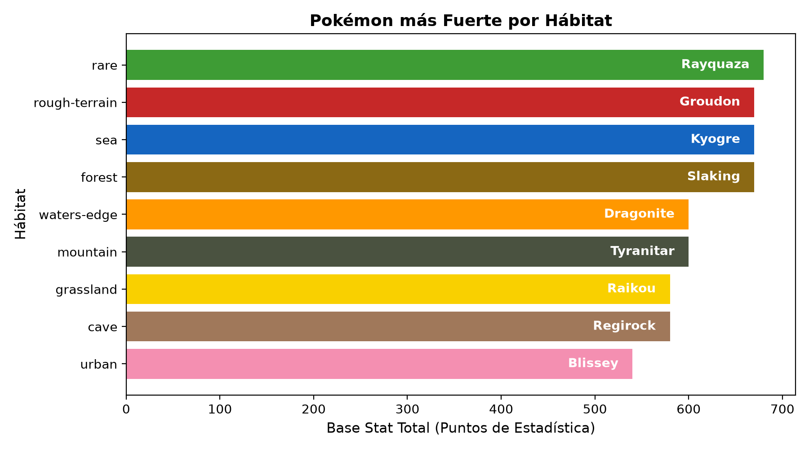
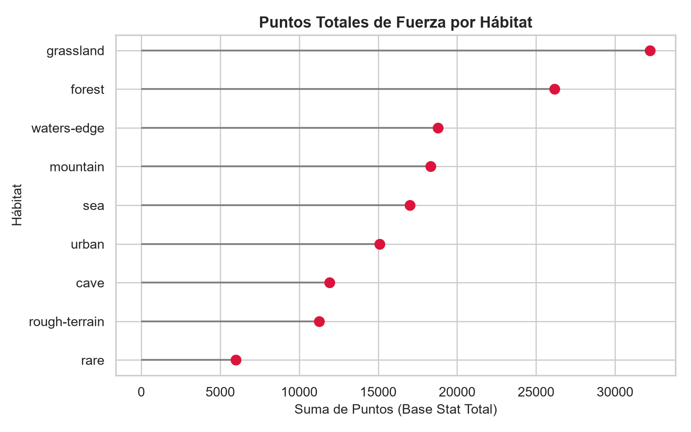
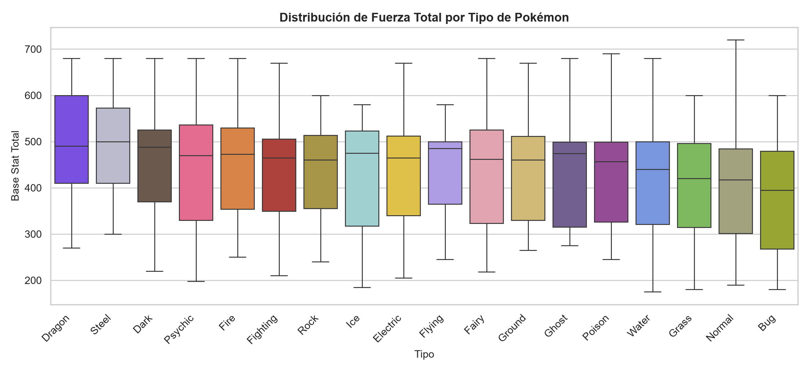
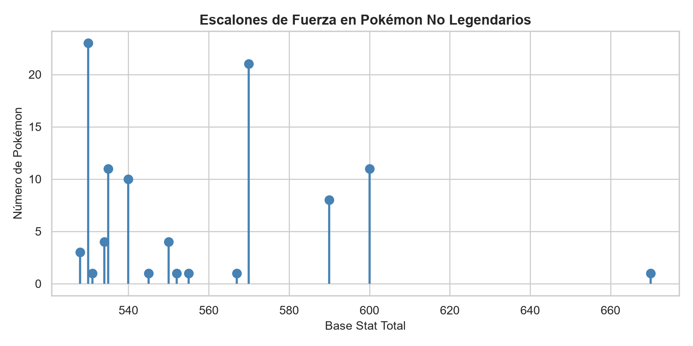
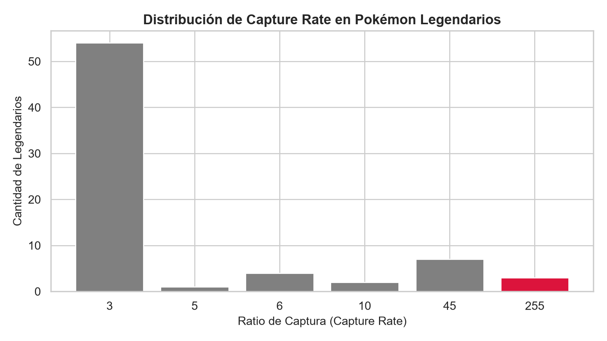

# Proyecto: Análisis de Datos Pokémon 🔴⚪

> **Memoria del proyecto de análisis de datos realizado en Python con Pandas, Matplotlib y Seaborn para la asignatura de Seguridad y Alta Disponibilidad.**

---

## 📌 Datos del Proyecto

| Campo | Información |
| :--- | :--- |
| **Módulo** | 0378 – Seguridad y Alta Disponibilidad |
| **Curso / Ciclo** | 2º de ASIX (Administración de Sistemas Informáticos en Red) |
| **Profesor** | Josep Mª Ruiz Ríos |
| **Alumnos** | [Nombre Alumno 1] & [Nombre Alumno 2] |
| **Curso escolar** | 2026 – 2027 |
| **Repositorio** | [notebook-pokemon](https://github.com/umbyx-ai/notebook-pokemon) |

---

## 📑 Índice
1. [Introducción y elección del tema](#1-introducción-y-elección-del-tema)
2. [Descripción del dataset](#2-descripción-del-dataset)
3. [Limpieza y tratamiento de los datos](#3-limpieza-y-tratamiento-de-los-datos)
4. [Exploración inicial (EDA)](#4-exploración-inicial-eda)
5. [Resolución de las 5 preguntas planteadas](#5-resolución-de-las-5-preguntas-planteadas)
   - [5.1. Pregunta 1: Pokémon más fuerte por hábitat](#51-pregunta-1-pokémon-más-fuerte-por-hábitat)
   - [5.2. Pregunta 2: Hábitat con más puntos de fuerza](#52-pregunta-2-hábitat-con-más-puntos-de-fuerza)
   - [5.3. Pregunta 3: Tipo de Pokémon más fuerte de media](#53-pregunta-3-tipo-de-pokémon-más-fuerte-de-media)
   - [5.4. Pregunta 4: Pokémon no legendario más fuerte](#54-pregunta-4-pokémon-no-legendario-más-fuerte)
   - [5.5. Pregunta 5: Legendarios con mayor ratio de captura](#55-pregunta-5-legendarios-con-mayor-ratio-de-captura)
6. [Conclusiones](#6-conclusiones)
7. [Estructura del repositorio](#7-estructura-del-repositorio)

---

## 1. Introducción y elección del tema

Este proyecto forma parte de la asignatura **0378 – Seguridad y Alta Disponibilidad** en 2º de ASIX. El objetivo era trabajar en pareja utilizando Python, Jupyter Notebooks y librerías de análisis de datos (Pandas, NumPy, Matplotlib y Seaborn), subiendo todo el trabajo a un repositorio compartido en GitHub.

### ¿Por qué elegimos Pokémon?
Escogimos este tema principalmente porque es una saga que nos gusta mucho a los dos y sobre la que ya teníamos bastante conocimiento previo. Al conocer bien los juegos, los tipos, las estadísticas y las mecánicas, sabíamos que podíamos plantear preguntas con sentido y entender fácilmente si los datos que nos devolvía el código eran correctos o si había algún error. Además, es un dataset muy completo para trabajar, ya que combina números (vida, ataque, defensa, velocidad...) con categorías (tipos, hábitats, generaciones).

### Organización del trabajo
Repartirnos las preguntas no tuvo ninguna complicación: lo echamos a suertes. A uno le tocó hacer la exploración inicial y las preguntas 1 y 3, y al otro las preguntas 2, 4 y 5. Para coordinarnos usamos GitHub Desktop, con el que ya habíamos trabajado anteriormente en otras prácticas, por lo que el flujo de hacer commits, pull y push fue cómodo y sin conflictos.

---

## 2. Descripción del dataset

El archivo original procede de Kaggle (`pokemon_complete.csv`). Después de revisarlo y limpiarlo, generamos nuestro propio archivo definitivo: **`pokemon.csv`**, que contiene **1.025 filas** (una por cada Pokémon de la Pokédex Nacional) y **15 columnas**:

| Columna | Tipo de dato | Descripción |
| :--- | :---: | :--- |
| `pokedex_number` | `int64` | Número oficial en la Pokédex (del 1 al 1025). |
| `name` | `object` | Nombre del Pokémon. |
| `type_1` | `object` | Tipo principal del Pokémon (Fuego, Agua, Planta, Dragón...). |
| `hp` | `int64` | Puntos de vida base. |
| `attack` | `int64` | Puntos de ataque físico. |
| `defense` | `int64` | Puntos de defensa física. |
| `sp_attack` | `int64` | Puntos de ataque especial. |
| `sp_defense` | `int64` | Puntos de defensa especial. |
| `speed` | `int64` | Velocidad de combate. |
| `base_stat_total` | `int64` | Suma de todas las estadísticas de combate anteriores. |
| `generation` | `int64` | Generación en la que se introdujo (del 1 al 9). |
| `is_legendary` | `bool` | Si es legendario (`True` o `False`). |
| `is_mythical` | `bool` | Si es singular o mítico (`True` o `False`). |
| `habitat` | `object` | Hábitat asignado (bosque, mar, cueva, etc.). |
| `capture_rate` | `int64` | Facilidad de captura (cuanto más alto, más fácil). |

---

## 3. Limpieza y tratamiento de los datos

Antes de ponernos a responder las preguntas, revisamos el archivo y tomamos varias decisiones de limpieza:

1. **Eliminar columnas irrelevantes (de 31 a 15)**:  
   El dataset original venía con 31 columnas. Borramos directamente todas aquellas que no aportaban nada a las preguntas que íbamos a responder o que eran solo datos cosméticos, como las URLs de las imágenes (`sprite_url`), los textos de la Pokédex (`flavor_text`), las alturas, pesos, grupos de huevo o habilidades.

2. **Filtrar a las 1.025 especies base (de 1.350 a 1.025 filas)**:  
   El archivo original tenía 1.350 filas porque incluía megaevoluciones y formas regionales con números de Pokédex superiores a 10.000. Decidimos quedarnos únicamente con los 1.025 Pokémon oficiales de la Pokédex Nacional para que cada especie contara una sola vez y no falseara las medias de los tipos ni de los hábitats.

3. **El paréntesis sobre la columna `habitat`**:  
   Al revisar los valores nulos (`df.isnull().sum()`), vimos que la única columna con datos faltantes era `habitat`, con 639 nulos. Investigando el motivo, vimos que la función de hábitats solo existió oficialmente en los juegos de la 3ª Generación (*Rojo Fuego y Verde Hoja* para Game Boy Advance), donde se catalogaron los 386 Pokémon que existían en ese momento. A partir de la 4ª generación, Game Freak dejó de usar esta clasificación.  
   Como era un tema interesante para responder a las dos primeras preguntas, **decidimos mantenerla haciendo ese breve paréntesis explicativo**, utilizando `dropna(subset=['habitat'])` solo cuando analizamos los hábitats para no tener que tirar a la basura el resto de Pokémon en las demás preguntas.

---

## 4. Exploración inicial (EDA)

En el notebook `00_exploracion_inicial.ipynb` cargamos el dataset y sacamos las estadísticas descriptivas generales de todos los Pokémon con `.describe()`:

| Métrica | HP | Attack | Defense | Sp. Atk | Sp. Def | Speed | Base Stat Total |
| :--- | :---: | :---: | :---: | :---: | :---: | :---: | :---: |
| **Media** | 69.9 | 78.8 | 74.2 | 71.7 | 71.8 | 68.0 | **435.5** |
| **Desv. estándar** | 26.1 | 32.1 | 30.7 | 32.3 | 27.7 | 29.3 | **120.9** |
| **Mínimo** | 1.0 | 5.0 | 5.0 | 10.0 | 20.0 | 5.0 | **175.0** |
| **Mediana (50%)** | 68.0 | 75.0 | 70.0 | 65.0 | 70.0 | 65.0 | **450.0** |
| **Máximo** | 255.0 | 190.0 | 250.0 | 194.0 | 250.0 | 200.0 | **720.0** |

Viendo la tabla, la media general de estadísticas de un Pokémon se queda en unos **435 puntos**, con una mediana de **450**. El mínimo del juego son 175 puntos y el máximo de esta lista base llega a 720 puntos (Arceus).

---

## 5. Resolución de las 5 preguntas planteadas

A continuación explicamos cómo resolvimos cada pregunta en su respectivo notebook y los resultados obtenidos. Como conocemos la franquicia, la mayoría de conclusiones salieron tal y como nos esperábamos.

---

### 5.1. Pregunta 1: Pokémon más fuerte por hábitat

> **Pregunta:** *De cada hábitat, ¿cuál es el Pokémon con más puntos de estadística total (`base_stat_total`)?*
> *(Notebook: `01_pokemon_mas_fuerte_por_habitat.ipynb`)*

Para responderla, filtramos los Pokémon que sí tenían hábitat asignado, agrupamos por `habitat` y nos quedamos con el valor máximo de cada grupo (`idxmax()`).

| Hábitat | Pokémon más fuerte | Base Stat Total |
| :--- | :--- | :---: |
| 🥇 **rare** | **Rayquaza** | **680** |
| 🥈 **sea** | Kyogre | 670 |
| 🥈 **forest** | Slaking | 670 |
| 🥈 **rough-terrain** | Groudon | 670 |
| 🥉 **waters-edge** | Dragonite | 600 |
| 🥉 **mountain** | Tyranitar | 600 |
| **cave** | Regirock | 580 |
| **grassland** | Raikou | 580 |
| **urban** | Blissey | 540 |



* **Comentario:** En el gráfico horizontal pusimos a cada Pokémon con un color representativo suyo. El más fuerte resultó ser **Rayquaza** con 680 puntos en el hábitat raro, seguido de Kyogre en el mar (670), Slaking en el bosque (670) y Groudon en terreno accidentado (670). Cabe mencionar que en el hábitat raro Mewtwo también tiene 680 puntos, empatando en la máxima puntuación.

---

### 5.2. Pregunta 2: Hábitat con más puntos de fuerza

> **Pregunta:** *¿Cuál es el hábitat con más puntos de fuerza basándonos en los puntos de estadística?*
> *(Notebook: `02_habitat_con_mas_fuerza.ipynb`)*

Aquí analizamos dos cosas: qué hábitat tiene la media de fuerza más alta y cuál tiene más puntos sumando todos sus Pokémon.

| Criterio | Hábitat ganador | Puntuación |
| :--- | :---: | :---: |
| **Por media de fuerza** | `rare` | **599.6 puntos de media** |
| **Por suma total de puntos** | `grassland` | **32.216 puntos totales** |



* **Comentario:** Si miramos la media, el hábitat más fuerte es claramente **`rare`** con casi 600 puntos de media, lo cual es normal porque casi todos los que viven ahí son legendarios (Mewtwo, las aves legendarias, Rayquaza...). Pero si miramos la suma total acumulada, gana **`grassland`** (pradera) con más de 32.000 puntos porque es el hábitat donde más Pokémon hay metidos (80 especies).

---

### 5.3. Pregunta 3: Tipo de Pokémon más fuerte de media

> **Pregunta:** *De cada tipo de Pokémon, ¿cuál es el tipo más fuerte de media (basándonos en los puntos de estadística)?*
> *(Notebook: `03_tipo_mas_fuerte_de_media.ipynb`)*

Agrupamos los 1.025 Pokémon por su tipo principal (`type_1`), calculamos la media de cada uno y además hicimos un diagrama de caja (*Boxplot*) para ver cómo se reparten las estadísticas dentro de cada tipo.

| Posición | Tipo | Media Base Stat Total |
| :---: | :--- | :---: |
| 🏆 **1º** | **Dragon (Dragón)** | **490.2** |
| 🥈 **2º** | Steel (Acero) | 475.1 |
| 🥉 **3º** | Dark (Siniestro) | 454.7 |
| **4º** | Psychic (Psíquico) | 446.7 |
| **5º** | Fire (Fuego) | 446.2 |
| ... | ... | ... |
| **17º** | Normal | 399.8 |
| 📉 **18º** | **Bug (Bicho)** | **374.6** |



* **Comentario:** Como ya nos esperábamos, el tipo más fuerte de media es el **Dragón (490.2)**, seguido de cerca por el tipo **Acero (475.1)**. Son tipos pensados en el juego para ser poderosos y con muchos Pokémon finales y legendarios. En cambio, el tipo **Bicho** es el más débil de media (374.6) porque la mayoría son los primeros bichos que te encuentras al inicio de la aventura y evolucionan rápido pero con estadísticas bajas.

---

### 5.4. Pregunta 4: Pokémon no legendario más fuerte

> **Pregunta:** *De los Pokémon no legendarios ni míticos, ¿cuál es el más fuerte?*
> *(Notebook: `04_no_legendarios_mas_fuertes.ipynb`)*

Filtramos para quitar legendarios y míticos (`is_legendary == False` y `is_mythical == False`) y ordenamos de mayor a menor fuerza.

| Posición | Pokémon | Tipo | Base Stat Total |
| :---: | :--- | :---: | :---: |
| 🥇 **1º** | **Slaking** | Normal | **670** |
| 🥈 **2º (Empate a 600)** | Hydreigon | Siniestro | 600 |
| 🥈 **2º (Empate a 600)** | Kommo-o | Dragón | 600 |
| 🥈 **2º (Empate a 600)** | Goodra | Dragón | 600 |
| 🥈 **2º (Empate a 600)** | Baxcalibur | Dragón | 600 |



* **Comentario:** El Pokémon no legendario más fuerte de todos es **Slaking con 670 puntos**. Ya sabíamos que esto saldría así: Slaking tiene más estadísticas que muchos legendarios, pero el juego lo compensa dándole su habilidad obligatoria *Ausente* (*Truant*), que hace que pierda un turno de cada dos sin atacar. Justo detrás de él están los 11 "pseudolegendarios" habituales empatados con 600 puntos exactos (Dragonite, Tyranitar, Salamence, Garchomp...).

---

### 5.5. Pregunta 5: Legendarios con mayor ratio de captura

> **Pregunta:** *De los legendarios, ¿cuál es el Pokémon con más capture rate (más fácil de capturar)?*
> *(Notebook: `05_legendarios_capture_rate.ipynb`)*

Filtramos los 71 Pokémon legendarios del dataset y ordenamos por su ratio de captura (`capture_rate`).

| Capture Rate | Cantidad de Legendarios | Ejemplos |
| :---: | :---: | :--- |
| **255 (Máximo posible)** | **3** | **Necrozma, Eternatus, Terapagos** |
| **45** | 7 | Rayquaza, Xerneas, Yveltal, Cosmog, Cosmoem, Solgaleo, Lunala |
| **10** | 2 | Zacian, Zamazenta |
| **6** | 4 | Wo-Chien, Chien-Pao, Ting-Lu, Chi-Yu |
| **5** | 1 | Ogerpon |
| **3 (Mínimo / Muy difícil)** | **54** | Mewtwo, Lugia, Ho-Oh, Articuno, Zapdos, etc. |



* **Comentario:** Los más fáciles son **Necrozma, Eternatus y Terapagos** con un ratio de **255** (el máximo del juego). Esto tiene una explicación muy sencilla que cualquier jugador conoce: son Pokémon que el juego te obliga a capturar como parte de la historia para poder avanzar, así que el ratio está puesto para que no se te escapen. En cambio, la gran mayoría (54 legendarios) tienen un ratio de 3, que es lo estándar para que atraparlos cueste bastante.

---

## 6. Conclusiones

* **Los datos respaldan lo que sabíamos del juego**: Al conocer la franquicia de antemano, los resultados no nos han sorprendido, pero ha sido muy interesante comprobar con datos y gráficos reales cosas como la superioridad de los Dragones, la anomalía de Slaking o los ratios de captura según la historia.
* **La importancia de limpiar el dataset**: Pasar de 31 a 15 columnas y quitar las formas duplicadas con IDs raros nos facilitó mucho la vida a la hora de trabajar con los notebooks sin liarnos.
* **Manejo de nulos**: Descubrir por qué faltaban datos en `habitat` nos enseñó que antes de borrar nulos a lo loco hay que entender el motivo por el cual faltan esos datos en el dataset original.
* **Trabajo en equipo con GitHub**: Como ya habíamos utilizado Git y GitHub Desktop en otras prácticas, repartirnos el trabajo a suertes y sincronizar los notebooks no nos dio ningún problema.

---

## 7. Estructura del repositorio

```text
notebook-pokemon/
│
├── 00_exploracion_inicial.ipynb            # Carga, limpieza y estadísticas descriptivas generales
├── 01_pokemon_mas_fuerte_por_habitat.ipynb # Pregunta 1: Pokémon líder por hábitat
├── 02_habitat_con_mas_fuerza.ipynb         # Pregunta 2: Comparativa de fuerza de hábitats
├── 03_tipo_mas_fuerte_de_media.ipynb       # Pregunta 3: Medias y Boxplot por tipo elemental
├── 04_no_legendarios_mas_fuertes.ipynb     # Pregunta 4: Ranking no legendarios (Slaking)
├── 05_legendarios_capture_rate.ipynb       # Pregunta 5: Legendarios y facilidad de captura
│
├── pokemon.csv                             # Dataset final limpio y ordenado (1.025 filas x 15 columnas)
│
├── graficos/                               # Gráficos generados para el informe y el README
│   ├── pregunta_1.png
│   ├── pregunta_2.png
│   ├── pregunta_3.png
│   ├── pregunta_4.png
│   └── pregunta_5.png
│
├── presentacion/                           # Presentación interactiva en HTML/CSS/JS
│   └── index.html
│
└── README.md                               # Memoria del proyecto
```